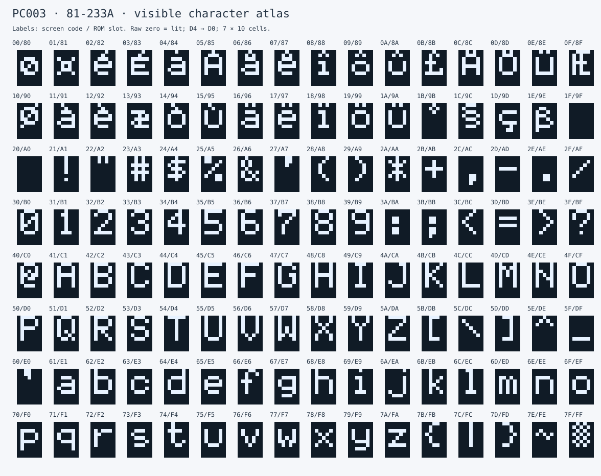

# PC003 Kaypro 2 character ROM, label 81-233A

The character ROM of the owner's Kaypro 2 (unit PC003), handwritten label
81-233A. It contains accented Latin alternate glyphs and differs from the
public 81-146 and 81-146A images. The chip's factory marking is hidden; the
sticker was left intact.

## Acquisition

Read with the owner's T48 on 2026-11-13.

The 81-241 CRT schematic (sheet 2C, technical manual 1484-E page 6-15)
specifies U43 as a standard 2716. That is the basis for the 2 KiB read profile,
not a newly observed factory marking. Two independent reads match exactly;
contact checks passed and both operations reported successful pin-driver reset.
Only the explicit 5 V read path was used. The ~11 V ADC VPP reading in the logs
is the internal generator, which was not routed to the chip; no programming
pulses were issued. Tool revision, hashes and exact commands are in [evidence/session.json](evidence/session.json).

The image differs in 256 bytes from retrocmp's 81-146 and in 236 bytes from
its 81-146A (the latter matches MAME's 81-146.u43 SHA-1). These differences also
exist in the low five pixel bits. Raw and inverted capture hashes do not match
MAME's listed image. Reference URLs and checksums are in manifest.json.
This establishes a distinct capture from those two references, not proof of
an unpublished or owner-modified font.

## Glyph analysis and visualizations

[Full analysis, reference comparison and reproducible tools](analysis/README.md).

The closest checked reference differs in **42 of 128 visible glyphs**. All 32
alternate slots change, largely to accented Latin letters and European symbols;
ten ordinary glyphs also have shape changes. This is consistent with a regional
font variant, but the country, maker and official status of the handwritten
81-233A designation remain unknown.

[View every changed glyph side by side with 81-146A](analysis/differences.svg).

No license is asserted over this historical ROM. The binary is unmodified.
