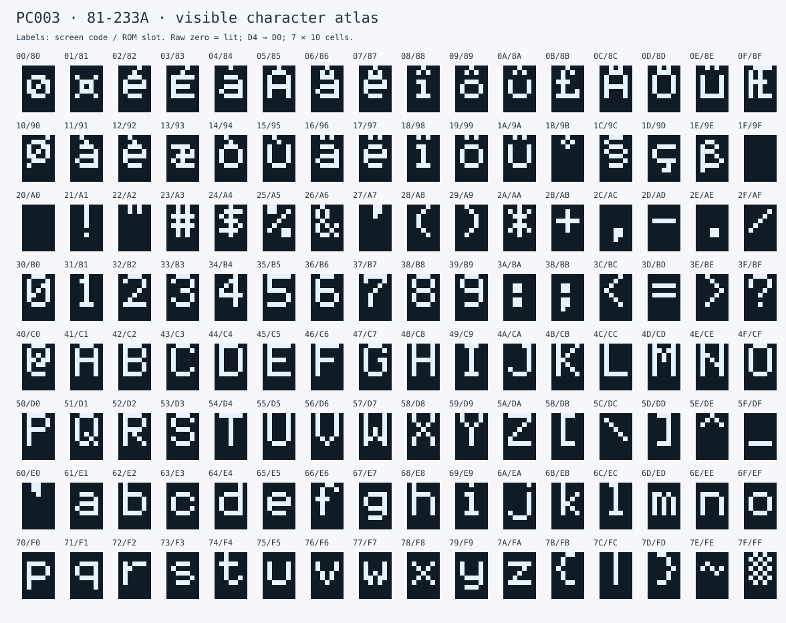
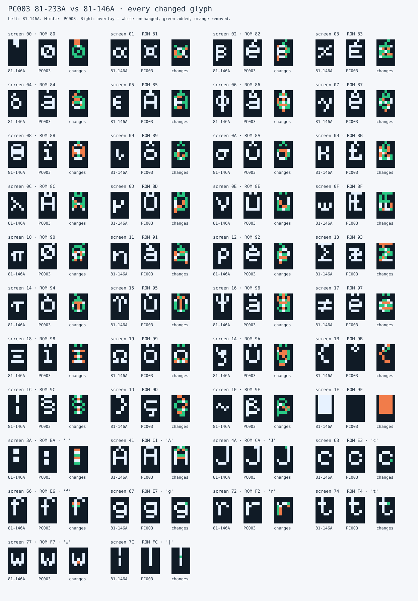

# PC003 character-ROM analysis

The repeat-read 2 KiB capture labelled **81-233A** differs from the closest
checked public image in **236 bytes and 42 visible glyphs**. Its alternate
character block contains accented Latin letters and European symbols where
the reference has Greek letters and special symbols. This is consistent with
a regional character-set variant; country, author and official part-number
status remain unknown. A handwritten sticker does not establish its origin.

## Visualizations

The figures are direct bit renderings of the captured bytes, with square
pixels and no CRT effects. Open the SVGs at full size to inspect the pixels.

### PC003's visible character set



### Every changed glyph, compared with 81-146A

Each group shows **reference → PC003 → change overlay**. In the overlay, white
pixels are lit in both, green pixels were added in PC003, and orange pixels
were removed. Dark pixels are unlit in both. “Added” and “removed” describe
the comparison direction, not an established historical sequence.



Also available: [full reference atlas](reference-atlas.svg),
[all 256 raw ROM slots](raw-slots.svg), [per-glyph CSV](changes.csv), and
[machine-readable comparison](comparison.json).

## Findings

| Measurement | Result |
| --- | ---: |
| ROM size | 2048 bytes |
| Different bytes | 236 (11.52%) |
| Changed visible glyphs | 42 of 128 |
| Unchanged visible glyphs | 86 of 128 |
| Added lit pixels | 335 |
| Removed lit pixels | 227 |
| Total changed pixel positions | 562 |
| Differences in unused D5–D7 | 0 |

- The first 1024 bytes are `FF` in both images: the blank half used for the
  blink-off phase. The second half holds 128 eight-byte glyphs.
- Every glyph at ROM slots `80–9F` differs (screen codes `00–1F`). The new
  shapes include accented vowels, umlauts, a pound sign, an AE ligature,
  a section sign, a cedilla character and an eszett-shaped character.
  These are visual identifications, not recovered character-name metadata.
  Slot `9F`, a filled block in the reference, is blank in PC003.
- The other changed screen codes are `3A 41 4A 63 66 67 72 74 77 7C`:
  `: A J c f g r t w |`. For example, PC003's `A` has a flat three-pixel
  top instead of the reference's pointed top; its vertical bar is continuous.
- All decimal digits and the other 86 visible glyphs are identical. Together
  with the concentrated alternate-block changes, this supports a related font
  variant rather than an unrelated character generator. It does not establish
  which image came first or exclude every possible acquisition defect.
- Both physical captures match and both contact checks passed. This supports
  repeatability; the images are not a new independent reader acquisition.

## Correct interpretation of the bytes

For a nonblinking video-memory code `c` in `00–7F`, the ROM slot is `c XOR 80`.
The eight row bytes start at `(c XOR 80) * 8`. Each row's connected pixel bits
are **D4, D3, D2, D1, D0**, left to right. The raw EPROM outputs are active-low:
**zero means a lit pixel**. A cell has a blank column on each side and two
blank scanlines below its eight ROM rows, giving a 7 × 10 cell.

The atlas labels are **video-memory code / ROM slot**, not Unicode numbers.
Codes `00–1F` are alternate glyph slots; sending those bytes to the CP/M
terminal does not necessarily display them, because terminal controls and
character-set selection are separate from video-memory addressing.
Blinking selects between the blank and visible halves; these figures show the
visible half only. The full raw-slot atlas explicitly includes the blank half.

This interpretation follows the [81-241 CRT schematic, U43, sheet 2C](https://retrocmp.de/kaypro/1985_1484-E_KayproTechnicalManual.pdf#page=35)
and is cross-checked against [MAME's Kaypro II video renderer](https://github.com/mamedev/mame/blob/master/src/mame/kaypro/kaypro_v.cpp).
MAME's [ROM definition](https://github.com/mamedev/mame/blob/master/src/mame/kaypro/kaypro.cpp)
uses `ROMREGION_INVERT` before rendering. Feeding this unmodified dump into
a renderer that expects already-inverted pixel bytes would reverse the image.
The preserved `.bin` is never inverted or otherwise transformed.

## Reference and identity limits

The reference is [retrocmp's 81-146A download](https://retrocmp.de/dwnld/U43_CHAR_81-146A_2716_2K.ROM),
whose SHA-1 is `5cb880083b94bd8220aac1f87d537db7cfeb9013` and CRC32 is
`4cc7d206`. Those bytes match the image MAME names `81-146.u43`; the different
filenames do not represent two different comparisons.

| Checked public image | Differing bytes from PC003 |
| --- | ---: |
| retrocmp `81-146` | 256 |
| retrocmp `81-146A` / MAME `81-146.u43` | 236 |
| mrynet `kayproii_u43.bin` (same reference bytes) | 236 |
| mrynet `omni_ii_u43.bin` | 1469 |

The older images are in [mrynet's Kaypro archive](https://www.mrynet.com/FTP/os/Kaypro/kaypro_roms/).
“Closest” means closest among these checked images, not among every surviving
Kaypro ROM. Web searches for `81-233A`, `81-233`, CRC32 `e7019c90` and the
capture SHA-1 found no matching prior publication on 2026-11-13. This is not
proof that the image was previously unpublished. The [collector catalogue](https://retrocmp.de/kaypro/kay-p24_rom.htm)
also names Micro Cornucopia CLEAN/GREEK variants; no byte comparison with
those replacements is claimed here.

## Reproduce

Run from this directory with Python 3. The script downloads the reference into
memory, verifies its SHA-1 and the capture's SHA-256, and writes the SVGs, JSON
and CSV. No reference-ROM binary is added to this repository.

```sh
python3 analyze.py
# Offline, with the exact reference already downloaded:
python3 analyze.py --reference /path/to/U43_CHAR_81-146A_2716_2K.ROM
# Generate elsewhere for a reproducibility comparison:
python3 analyze.py --reference /path/to/reference.bin --out /tmp/pc003-analysis
```

The script checks the known space and `A` patterns to catch polarity, bank and
bit-order mistakes, and independently reconciles byte and pixel counts.
The analysis program is MIT-licensed; no license is asserted over either
historical ROM or the glyph designs. The SVGs are derived illustrations.
