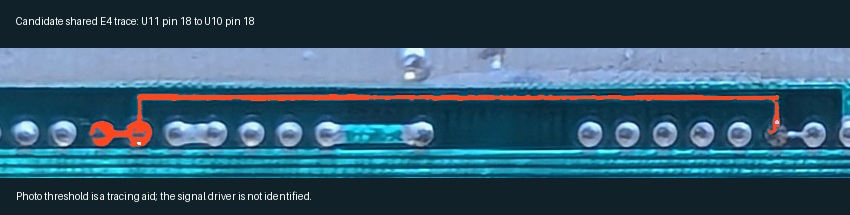
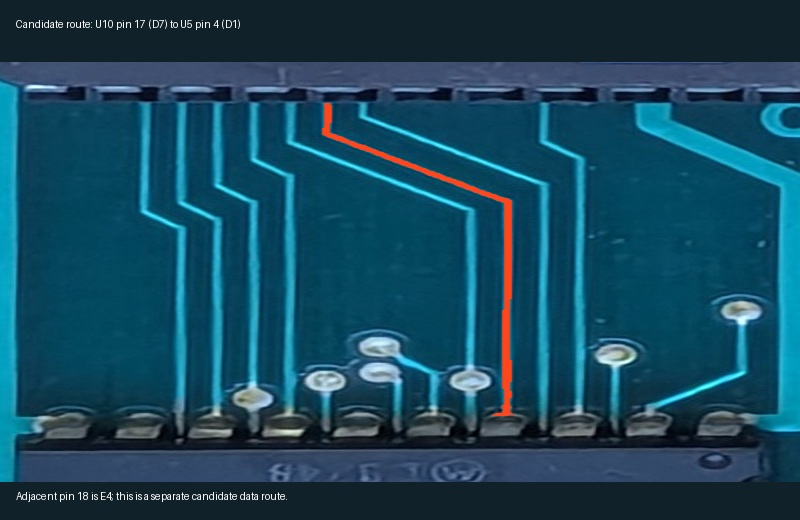
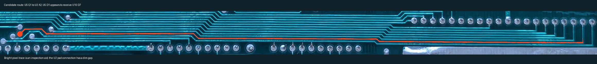

# Photo constraints reopen the register-field candidates

The backside photograph provides three candidate routes from U6 to the B-address
inputs of U2. Combined with the existing U11→U6 PROM/register bundle hypothesis,
these favor the opposite A/B register roles from q1–q4. They are photo
interpretations, not continuity measurements or a complete recovered decode.


| Candidate | Register output | Am2901 input | If the PROM/register bit order is identity |
|---|---|---|---|
| PB1 | U6 pin 9, Q3 | U2 pin 18, B1 | B1 = PROM 11 bit 3 |
| PB2 | U6 pin 6, Q2 | U2 pin 19, B2 | B2 = PROM 11 bit 2 |
| PB3 | U6 pin 5, Q1 | U2 pin 20, B3 | B3 = PROM 11 bit 1 |

Q numbering is zero-based. Pin interpretation uses the package orientation in
the front photo, the [TI LS374 pin diagram](https://www.ti.com/lit/ds/symlink/sn74ls374.pdf)
and [AMD Am2901 P-40/D-40 diagram](https://pccomponents.com/datasheets/ADVAN-AM2901BDMB.pdf),
PDF page 3. The [constraint file](photo-b-constraints.json) records endpoints,
image coordinates, original-photo hash and unresolved observations. The overlay
colors connected bright pixels to help inspect the paths; it is not an
electrical connectivity measurement. Dim copper leaves gaps, and looser color
thresholds can merge neighboring traces.

The weaker, useful constraint does **not** require identity bit order: if U6
receives the U11 data bundle, these B inputs must come from chip 11. Five of
the six existing mappings instead put their B field in chips 17/18. Only
`fitted_swapped` passes that source-lane check. This is conditional evidence
against those five register-role choices, not against all their other fields.

The source bundle and its individual bit order remain assumptions. Its
front-side tracks pass under packages; a track lined up with a PROM pad is
not enough to assign the corresponding data bit. A fourth possible route,
U6 Q0 toward U2 A0, is not used in the original three-route screen. It is
examined below; its highlighted segment still stops below the target pad, so
the connection remains conditional. If confirmed, it challenges more of the
current field layout.
Neither U8's matching inputs nor B0 has been traced here.

Two separate [U8-to-U2 facing-pad candidates](PHOTO-SLICE-LINK.md) may join
U8 I4 to U2 I1 and U8 I6 to U2 I2. Both visible segments have unresolved
pad gaps. If confirmed, they conflict with the current shared-instruction
interpretation of all five photo-constrained mappings and call for a
split-slice instruction model or different field assignments; they do not
by themselves identify the modem routine.

## Executable alternatives

[The runner](photo_b_constraints.py) screens all six existing mappings and
generates four new ones: `q1-photo-swapped` through `q4-photo-swapped`. Each
exchanges the complete A/B fields while retaining its original nine-bit
instruction mapping. The complete swap is broader than the evidence: the
A field, B0, bit permutation and instruction controls remain hypotheses.
All four pass the three candidate source-lane constraints, so the photos do
not uniquely select `fitted_swapped` or any other complete mapping.

The real PROMs are executed through the board models with unknown initial RAM/Q,
the existing assumed fetch/execute schedule, literal branch target, D=0,
carry=0, and fixed TEST=0/1 or the cycle-17 pulse. Twelve 128-instruction runs
complete. Fixed TEST still leaves every RAM byte at least partly unknown in
these four variants. The pulse visits 67 instruction addresses and returns to
084, while making respectively **2, 4, 6 and 7 RAM bytes** fully known in the
four variants. These are initialization observations, not DAC output or a
controller handshake.

[Mappings, traces and report](results/photo-b-constraints/) preserve the runs.
The baseline mappings and evidence-only board remain unchanged. Tests check
that lane compatibility is distinct from exact bit agreement and that the
new A/B choices actually reach the board model without mutating the old mapping.

## Corrected ROM-read search

Reviewing the new candidates exposed a separate error in
`all_rom_gate_cycles.py`: it reused the `d_selected_pcs` list computed for q3
when testing the other mappings. That silently excluded valid D-input
instructions. The screen now uses each gate's activation addresses and decodes
operand selection independently for every mapping. Shift destinations are also
counted as state writes.

The corrected cyclic D-write candidates under the 137 diagnostic gate fits are:

| Mapping family | Candidate addresses |
|---|---|
| q3/q4, including their new A/B swaps | 1EC, 36C, 36E |
| q1/q2, including their new A/B swaps | 05E, 061, 127, 12C, 1EC, 36C, 36E |
| fitted_original / fitted_swapped | 187, 1EC, 299, 29B, 29C, 36C, 36E |

The earlier assertion that all six mappings had only the same three sites is
withdrawn. The [corrected report](results/all-rom-gate-cycles.json) includes
the operations and register addresses. Its top-level gate summaries remain
explicitly scoped to q3. These gates were fitted to diagnostic labels, so none
of these addresses is established as a physical lookup-ROM read.

The next runtime targets are the newly admitted 05D–063, 126–130, 187–188 and
298–29E loops under compatible register-role hypotheses. Their ROM address,
retained state, surrounding calls and external transfer timing need to explain
signal processing. The goal remains the controller-driven transmitter plus
receiver or echo canceller; neither a photo-compatible mapping nor these
bounded executions satisfy G2.

## I7 instruction input is a new conditional constraint

The [AMD Am2901 package diagram](https://deramp.com/downloads/mfe_archive/050-Component%20Specifications/AMD/2900%20Family/amd-2901b-c.pdf)
confirms that U2 pin 7 is **I7** (and that pins 18–20 are B1–B3 as used
above). In the rectified back photograph, a bright track from U2 pin 7
reaches a via near `(713, 1602)`; the corresponding front-side segment appears
to connect that via to **U6 pin 2, Q0**. The front photograph also shows a
separate track from **U6 pin 3, D0** toward **U11 pin 18**. The
[MMI 6381 pin diagram](https://bitsavers.trailing-edge.com/components/mmi/_dataBooks/1978_MMI_Bipolar_LSI_Databook_1ed.pdf)
labels that U11 pin **E4, an enable input**, rather than a PROM data output.
These are candidate photo routes, not continuity measurements. The
[coordinate and source record](photo-i7-constraint.json) distinguishes the
two routes and their unverified continuations.


The highlight follows one bright-pixel component from the U11 pin-18 pad
vicinity to the U6 pin-3 pad vicinity; neighboring tracks remain separate at
the recorded threshold. It helps inspect this particular photo interpretation,
but cannot establish electrical continuity or the net's driver.

The back photograph shows another candidate segment joining U11 pin 18 to
U10 pin 18; U11 pin 19 (E3) also appears to touch it. The MMI pinout labels
E3 and E4 as enable inputs, and the [MMI operating description](https://electronicsandbooks.com/edt/manual/Electronic%20Component%20Databook%20Datasheet/Brand/MMI%20Monolithic%20Memories%20Incorporated%20%28AMD%201987%29/Databook/1975%20MMI%20Semiconductors%20Data%20Applications%20c20130212%20%5B252%5D.pdf)
requires both high for a 6381 read. Therefore **if** these photo segments
are one net, it must be high while the corresponding PROMs provide data;
whether U6 captures it then is a timing question. The highlighted segment
does not reveal its driver.



There is also a distinct front-side candidate from **U10 pin 17** to **U5 pin
4, D1**. Pin 17 is the D7 output in the [documented PROM reader map](../../../microcode-810237c-810240c/README.md),
while the adjacent pin 18 is E4. This suggests one actual data-bit permutation,
U10 D7 → U5 D1, without making U5's other seven bits identity-wired.

A [corrected photo fragment and execution probe](PHOTO-U10-D4.md) places
U10 pin 14 (D4) near **U5 pin 9 (Q3 output)**, not pin 8 (D3 input).
It may be a shared output bus with enable timing, but does not establish a
PROM-to-latch data bit or an Am2901 instruction/register-address bit.



The corresponding U5 pin 5, Q1, appears to pass through a front-side via and
along a back-side track to **U2 pin 2, A2**. The bright-pixel component ends
just short of the U2 pad in a dim segment; this and the approximate via
registration keep the whole path conditional. If it is connected, A2 takes
**PROM 10 bit 7** after the U5 latch. All ten current full mappings use
`11.2` or `17.7` for A2 instead. The [photo A2 screen and run](photo_a2_probe.py)
changes only this one field bit in the q3 photo-swapped fixture. With the
earlier PROM-bit I7 baseline, both A2 choices still visit 38E 39 times;
with candidate E4-high I7, neither visits it. This fixture therefore cannot
separate A2 by control flow, but the photo route challenges the current
register-address layouts. [Counts and source hashes](results/photo-a2-probe/report.json)
are saved.



Another back-side track appears to run from **U6 pin 2, Q0** to **U2 pin 4,
A0**. This is the same U6 output implicated at U2 I7, so the photo candidate
ties **A0 and I7 together after the U6 latch**. All current mappings instead
assign them separate PROM bits. The U2 pad has a dim gap, so the tie remains
conditional; the original photograph and [highlighted segment](results/photo-i7-probe/candidate-a0-route.jpg)
allow that interpretation to be reviewed.

The [local transform check](PHOTO-TRANSFORM-CHECK.md) applies this possible
A0/I7 tie to the 3C5/3DA four-entry tables. Under the simple coupled-pin
interpretation, their earlier G1 quarter-turn identity fails for every
four-word signal pattern tested; an uncoupled control gives sign selection
instead. This narrows the mapping interpretation without confirming the tie.

The emulator can now supply an explicitly labelled constant to both a register
address input and an instruction input. The [coupled A0/I7 run](photo_a2_probe.py)
tests levels 0 and 1, with and without the photo A2 correction. Every coupled
run completes 512 real-PROM instructions and reaches 084 without visiting
38E or 392–39F. At level 1, correcting A2 changes the full trace digest but
not this control-flow outcome. These bounded runs disfavor the old q3
output-loop interpretation under the photo candidate; they do not yet recover
the net's driver, latch timing or the real transmitter path.

If those routes are correct, I7 is a latched version of the signal on U11's
E4 input. That would invalidate the earlier assumption that U6 D0 takes a
U11 data-output bit: I7 is not identified as either `11.0` or `11.6`.
The broader U11→U6 bundle in [the board ledger](../board/nets.json) was already
marked inferred with unresolved bit order; this specific D0 path now challenges
even its data-source assignment. The signal driving E4, its polarity and the
U6 latch timing still need candidate models.

The earlier [`photo_i7_probe.py`](photo_i7_probe.py) result remains a useful
**counterfactual sensitivity test**, not a physical mapping result. In the
q3 photo-swapped phase-32 fixture, `I7=11.6` visits 38E and 38F 39 times
and executes 156 candidate output-table words in 512 instructions. Replacing
only I7 with `11.0` or `!11.0` reaches 084 without visiting those sites;
all three runs remain clean. The [saved report](results/photo-i7-probe/report.json)
records hashes and counts.

The emulator now accepts provenance-labelled constant instruction-bit inputs
in a scenario. [`photo_i7_control.py`](photo_i7_control.py) uses this to test
both fixed levels of the candidate E4-side signal at I7 while keeping the
same real PROMs and q3 fixture. **Both levels run cleanly but visit neither
38E nor 392–39F** in 512 instructions; the PROM-bit baseline visits 38E 39
times. The [report](results/photo-i7-control/report.json) saves the routes
and digests. A constant level is a diagnostic assumption, since the net's
driver and U6 latch timing remain unknown. The result makes the q3
controller-bit-output interpretation fragile under this photo route, and
directs the next mapping search toward the E4 signal and other output sites.

## Photo-constrained startup and controller-bit run

Two more photo interpretations extend the U5 candidate: U10 pin 16 (D6)
appears to feed U5 pin 7 (D2), whose Q2 appears to run to U2 pin 1 (A3).
U10 pin 20 (active-low E2) appears to reach U5 pin 3 (D0), whose Q0 appears
to run to U2 pin 12 (I0); U2 pin 3 (A1) appears to share the E2-side net.
The [coordinate record](photo-a-input-constraint.json) separates the visible
segments from their inferred continuations. The traces have dim pad/via gaps,
so these are **candidate routes**, not
measured continuity. They motivate A3=`10.6`, I0=0 and A1=0 in a diagnostic
fixture, alongside A2=`10.7` and the earlier I7=A0=1 candidate. The fixed
enable levels and latch timing are assumed; they do not establish the actual
board inputs.

The [reproducible run](photo_controller_path.py) sweeps all 256 initial Q
values with zero RAM. Exactly 32, those congruent to 5 modulo 8, visit 38E
within 512 cycles. Q=0 instead parks at 084. This sensitivity follows the
fixture's *assumed* Q-indexed branch table at 109; it does not identify the
real power-on Q value. Constant serial shift inputs 0/1 do not move the Q=0
fixture onto that path in the same window.

With Q=5, the run supplies 128 bits generated by locally executing the real
8031 ROM's scrambler at the *hypothetical* D read at 38E. All 128 bits are
consumed, and all 128 visits to 38F enter a complete four-word group. A zero
always gives ALU Y `[11, 11, 6, 6]` through dispatch index 251; a one always
gives `[11, 11, 16, 16]` through index 252. Reconstructed post-group RAM/Q,
flags and stack have only **one state per current bit** across the whole
stream. Thus this candidate path responds to bits but shows no retained bit
history, advancing phase or varying carrier samples at these points. The
[saved mapping, scenario, trace and report](results/photo-controller-path/)
make the negative and positive observations reviewable.

The same fixture was run for both repeated bit values under **every one of
the 32 active Q seeds**. Each of the 64 runs reaches 38F 39 times and produces
only one four-word ALU Y group throughout its run; Q also stays at its initial
value. The dispatch index follows `(bit - initial_Q) mod 256` in all 64 cases.
The fixed output therefore depends on the starting Q and current bit, but
none of these active seeds reveals a running phase in this candidate path.
Each of these 64 seed/bit runs has three hypothesized Am27S31 reads during
startup and **none after the first 38F dispatch**. An independent screen of
all 137 previously fitted diagnostic ROM-enable gates at Q=5 likewise finds
39 complete dispatch groups but no post-dispatch ROM read or changing output
group in any 512-cycle run. These results narrow this mapping and gate family;
the physical ROM-enable wiring is still untraced.
At 38E the candidate instruction produces and stores `(D - Q) mod 256` in
RAM14, and 38F uses that preceding ALU result for a four-way dispatch.
This makes the path look more like a difference-driven table selection under
the current mapping than a phase accumulator. Interpreting D as a controller
bit is still only the test stimulus; a sampled line value is another plausible
source to test when the D bus is better constrained.

A diagnostic D sweep of bytes `00`–`FF` and then `FF`–`00` makes the
four-way behavior explicit. All 512 values are consumed; each of the four
entries receives 128 visits. The output groups depend only on `D mod 4`:
`0→[11,11,6,6]`, `1→[11,11,16,16]`, `2→[1,1,6,6]`, and
`3→[1,1,252,251]` with Q=5. The 256 distinct post-group states repeat
exactly when the same D value arrives in reverse order. In this fixture,
RAM14 retains the current D−Q difference, but the observed state does not
retain earlier values. A four-way selection could serve several modem jobs;
this experiment does not identify one.

These ALU values have no traced route to the physical DAC. The ROM gate,
dispatch timing and initial state remain assumptions, so the result is not
G2's transmitter test. It does narrow the next search: a viable mapping or
output path must show carrier/phase evolution across repeated equal bits and
ultimately reproduce a line signal under controller stimulus.

```sh
python3 nokia/data-modem-2400-2400/analysis/microcode/g2/photo_b_constraints.py --render
python3 nokia/data-modem-2400-2400/analysis/microcode/g2/all_rom_gate_cycles.py
python3 nokia/data-modem-2400-2400/analysis/microcode/g2/photo_i7_probe.py
python3 nokia/data-modem-2400-2400/analysis/microcode/g2/photo_i7_trace.py
python3 nokia/data-modem-2400-2400/analysis/microcode/g2/photo_i7_control.py
python3 nokia/data-modem-2400-2400/analysis/microcode/g2/photo_a2_probe.py
python3 nokia/data-modem-2400-2400/analysis/microcode/g2/photo_controller_path.py
python3 -m unittest discover -s nokia/data-modem-2400-2400/analysis/microcode/g2 -v
python3 -m unittest discover -s nokia/data-modem-2400-2400/analysis/microcode/board -v
```

Rendering alone needs Pillow. Execution and tests use the existing standard-library
models; no new hardware measurements are needed to run these candidates.
