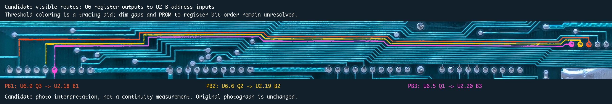
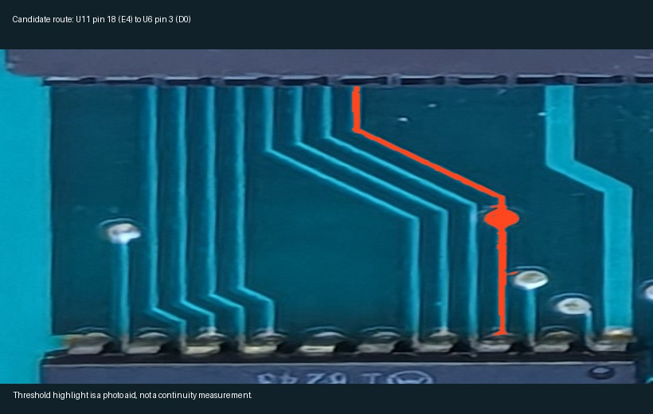

# Photo constraints reopen the register-field candidates

The backside photograph provides three candidate routes from U6 to the B-address
inputs of U2. Combined with the existing U11→U6 PROM/register bundle hypothesis,
these favor the opposite A/B register roles from q1–q4. They are photo
interpretations, not continuity measurements or a complete recovered decode.



| Candidate | Register output | Am2901 input | If the PROM/register bit order is identity |
|---|---|---|---|
| PB1 | U6 pin 9, Q3 | U2 pin 18, B1 | B1 = PROM 11 bit 3 |
| PB2 | U6 pin 6, Q2 | U2 pin 19, B2 | B2 = PROM 11 bit 2 |
| PB3 | U6 pin 5, Q1 | U2 pin 20, B3 | B3 = PROM 11 bit 1 |

Q numbering is zero-based. Pin interpretation uses the package orientation in
the front photo, the [TI LS374 pin diagram](https://www.ti.com/lit/ds/symlink/sn74ls374.pdf)
and [AMD Am2901 P-40/D-40 diagram](https://pccomponents.com/datasheets/ADVAN-AM2901BDMB.pdf),
PDF page 3. The [constraint file](photo-b-constraints.json) records endpoints,
image coordinates, original-photo hash and unresolved observations. The overlay
colors connected bright pixels to help inspect the paths; it is not an
electrical connectivity measurement. Dim copper leaves gaps, and looser color
thresholds can merge neighboring traces.

The weaker, useful constraint does **not** require identity bit order: if U6
receives the U11 data bundle, these B inputs must come from chip 11. Five of
the six existing mappings instead put their B field in chips 17/18. Only
`fitted_swapped` passes that source-lane check. This is conditional evidence
against those five register-role choices, not against all their other fields.

The source bundle and its individual bit order remain assumptions. Its
front-side tracks pass under packages; a track lined up with a PROM pad is
not enough to assign the corresponding data bit. A fourth possible route,
U6 Q0 toward U2 A0, is retained as an **incomplete fragment**: the highlighted
segment stops below the possible target pad. It is not used in the three-route
screen. If confirmed, it would challenge more of the current field layout.
Neither U8's matching inputs nor B0 has been traced here.

## Executable alternatives

[The runner](photo_b_constraints.py) screens all six existing mappings and
generates four new ones: `q1-photo-swapped` through `q4-photo-swapped`. Each
exchanges the complete A/B fields while retaining its original nine-bit
instruction mapping. The complete swap is broader than the evidence: the
A field, B0, bit permutation and instruction controls remain hypotheses.
All four pass the three candidate source-lane constraints, so the photos do
not uniquely select `fitted_swapped` or any other complete mapping.

The real PROMs are executed through the board models with unknown initial RAM/Q,
the existing assumed fetch/execute schedule, literal branch target, D=0,
carry=0, and fixed TEST=0/1 or the cycle-17 pulse. Twelve 128-instruction runs
complete. Fixed TEST still leaves every RAM byte at least partly unknown in
these four variants. The pulse visits 67 instruction addresses and returns to
084, while making respectively **2, 4, 6 and 7 RAM bytes** fully known in the
four variants. These are initialization observations, not DAC output or a
controller handshake.

[Mappings, traces and report](results/photo-b-constraints/) preserve the runs.
The baseline mappings and evidence-only board remain unchanged. Tests check
that lane compatibility is distinct from exact bit agreement and that the
new A/B choices actually reach the board model without mutating the old mapping.

## Corrected ROM-read search

Reviewing the new candidates exposed a separate error in
`all_rom_gate_cycles.py`: it reused the `d_selected_pcs` list computed for q3
when testing the other mappings. That silently excluded valid D-input
instructions. The screen now uses each gate's activation addresses and decodes
operand selection independently for every mapping. Shift destinations are also
counted as state writes.

The corrected cyclic D-write candidates under the 137 diagnostic gate fits are:

| Mapping family | Candidate addresses |
|---|---|
| q3/q4, including their new A/B swaps | 1EC, 36C, 36E |
| q1/q2, including their new A/B swaps | 05E, 061, 127, 12C, 1EC, 36C, 36E |
| fitted_original / fitted_swapped | 187, 1EC, 299, 29B, 29C, 36C, 36E |

The earlier assertion that all six mappings had only the same three sites is
withdrawn. The [corrected report](results/all-rom-gate-cycles.json) includes
the operations and register addresses. Its top-level gate summaries remain
explicitly scoped to q3. These gates were fitted to diagnostic labels, so none
of these addresses is established as a physical lookup-ROM read.

The next runtime targets are the newly admitted 05D–063, 126–130, 187–188 and
298–29E loops under compatible register-role hypotheses. Their ROM address,
retained state, surrounding calls and external transfer timing need to explain
signal processing. The goal remains the controller-driven transmitter plus
receiver or echo canceller; neither a photo-compatible mapping nor these
bounded executions satisfy G2.

## I7 instruction input is a new conditional constraint

The [AMD Am2901 package diagram](https://deramp.com/downloads/mfe_archive/050-Component%20Specifications/AMD/2900%20Family/amd-2901b-c.pdf)
confirms that U2 pin 7 is **I7** (and that pins 18–20 are B1–B3 as used
above). In the rectified back photograph, a bright track from U2 pin 7
reaches a via near `(713, 1602)`; the corresponding front-side segment appears
to connect that via to **U6 pin 2, Q0**. The front photograph also shows a
separate track from **U6 pin 3, D0** toward **U11 pin 18**. The
[MMI 6381 pin diagram](https://bitsavers.trailing-edge.com/components/mmi/_dataBooks/1978_MMI_Bipolar_LSI_Databook_1ed.pdf)
labels that U11 pin **E4, an enable input**, rather than a PROM data output.
These are candidate photo routes, not continuity measurements. The
[coordinate and source record](photo-i7-constraint.json) distinguishes the
two routes and their unverified continuations.



The highlight follows one bright-pixel component from the U11 pin-18 pad
vicinity to the U6 pin-3 pad vicinity; neighboring tracks remain separate at
the recorded threshold. It helps inspect this particular photo interpretation,
but cannot establish electrical continuity or the net's driver.

If those routes are correct, I7 is a latched version of the signal on U11's
E4 input. That would invalidate the earlier assumption that U6 D0 takes a
U11 data-output bit: I7 is not identified as either `11.0` or `11.6`.
The broader U11→U6 bundle in [the board ledger](../board/nets.json) was already
marked inferred with unresolved bit order; this specific D0 path now challenges
even its data-source assignment. The signal driving E4, its polarity and the
U6 latch timing still need candidate models.

The earlier [`photo_i7_probe.py`](photo_i7_probe.py) result remains a useful
**counterfactual sensitivity test**, not a physical mapping result. In the
q3 photo-swapped phase-32 fixture, `I7=11.6` visits 38E and 38F 39 times
and executes 156 candidate output-table words in 512 instructions. Replacing
only I7 with `11.0` or `!11.0` reaches 084 without visiting those sites;
all three runs remain clean. The [saved report](results/photo-i7-probe/report.json)
records hashes and counts.

The emulator now accepts provenance-labelled constant instruction-bit inputs
in a scenario. [`photo_i7_control.py`](photo_i7_control.py) uses this to test
both fixed levels of the candidate E4-side signal at I7 while keeping the
same real PROMs and q3 fixture. **Both levels run cleanly but visit neither
38E nor 392–39F** in 512 instructions; the PROM-bit baseline visits 38E 39
times. The [report](results/photo-i7-control/report.json) saves the routes
and digests. A constant level is a diagnostic assumption, since the net's
driver and U6 latch timing remain unknown. The result makes the q3
controller-bit-output interpretation fragile under this photo route, and
directs the next mapping search toward the E4 signal and other output sites.

```sh
python3 nokia/data-modem-2400-2400/analysis/microcode/g2/photo_b_constraints.py --render
python3 nokia/data-modem-2400-2400/analysis/microcode/g2/all_rom_gate_cycles.py
python3 nokia/data-modem-2400-2400/analysis/microcode/g2/photo_i7_probe.py
python3 nokia/data-modem-2400-2400/analysis/microcode/g2/photo_i7_trace.py
python3 nokia/data-modem-2400-2400/analysis/microcode/g2/photo_i7_control.py
python3 -m unittest discover -s nokia/data-modem-2400-2400/analysis/microcode/g2 -v
python3 -m unittest discover -s nokia/data-modem-2400-2400/analysis/microcode/board -v
```

Rendering alone needs Pillow. Execution and tests use the existing standard-library
models; no new hardware measurements are needed to run these candidates.
