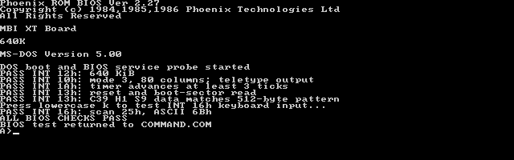
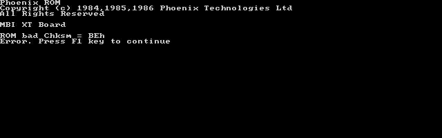

# Phoenix 2.27 MBI variant: corrected-image execution

The single-byte correction **passes POST, boots MS-DOS 5.00 and passes the
included BIOS-service probe** in 86Box 6.0 build 9001 (macOS arm64). The raw
control stops with `ROM bad Chksm = BEh` and requests F1. No F1 override was
used. Tests performed 2026-11-17.





## Exactly what changed

The raw 8 KiB capture remains untouched. The separate fixed image changes only
offset `0x1F3A`, from `00` to `42` (the `B` in `BIOS`). Its byte sum is zero.
`patch.json` records both hashes and the byte substitution.

The fixed image differs from the published 29MAY86 Phoenix 2.27 reference only
at offset `0x0013` (checksum adjustment) and `0x06B8–0x06C3` (MBI board-name
text replacing YANGTECH.INC). All other bytes match, including the corrected
byte. The public comparison source is recorded in the parent evidence folder.

## Test coverage and evidence

Configuration: generic XT, interpreted 8088 at 4.772728 MHz, 640 KiB RAM, CGA,
XT keyboard, 360 KiB floppy. Fast forward was used to shorten wall-clock waits.
No guest RAM injection, BIOS trap replacement, or additional ROM patches were
used. The only BIOS loaded is the chosen raw or fixed 8 KiB image at FE000h.

The corrected image completes POST's memory count, then boots original
MS-DOS 5.00 IO.SYS, MSDOS.SYS and COMMAND.COM from a newly prepared floppy.
AUTOEXEC runs the 8088-compatible `bioschk.asm` probe:

- INT 12h returns 640 KiB.
- INT 10h reports mode 3 and 80 columns; teletype output appears correctly.
- INT 1Ah advances at least three timer ticks.
- INT 13h resets drive A and reads the boot sector with its 55AA signature.
- INT 13h reads cylinder 39, head 1, sector 9 and verifies a full sector of A5.
- INT 16h receives a host keypress of lowercase k as scan 25h / ASCII 6Bh.
- DOS creates, writes and closes BIOSCHK.TXT, returns to COMMAND.COM, and
  `TYPE BIOSCHK.TXT` reads back the results. Host mtype independently extracts
  the same result file, retained as `fixed-results.txt`.

`fixed-dos-readback.png` shows the guest readback. `fixed-post-no-disk.png`
records the initial successful POST with no boot media. `results.json` records
the conclusions; `inputs.json` hashes the DOS source, files and test program.

This is strong evidence for the one-byte correction and working common BIOS
paths. It does not exercise every interrupt subfunction, error path, expansion
ROM, video mode, or motherboard-specific behavior. The physical EPROM has not
been rewritten or tested on another reader.

## Reproduce

Requires 86Box, its device ROM collection, NASM, mtools, Python 3 and an original
MS-DOS 5.00 720 KiB DISK1.IMG. The DOS media and external device ROMs are not
redistributed here. The test creates a 360 KiB FAT12 disk, preserves DOS boot
code with a matching BPB, copies the system files first, and fills the last
unallocated sector with a known test pattern.

```sh
python3 prepare.py --dos-disk /path/to/DISK1.IMG \
  --roms /path/to/86box-roms --output /tmp/mbi-fixed-test
/Applications/86Box.app/Contents/MacOS/86Box -N \
  -P /tmp/mbi-fixed-test -O /tmp/mbi-fixed-test/global.cfg \
  -R /tmp/mbi-fixed-test/roms
```

Wait for POST and DOS, then press lowercase **k** at the probe prompt. Expect
`ALL BIOS CHECKS PASS`, followed by the DOS prompt. Run `TYPE BIOSCHK.TXT` to
read the saved results. Use **Tools → Take raw screenshot** for a guest-only
screen capture. Shut down before inspecting the disk with mtools:

```sh
mtype -i /tmp/mbi-fixed-test/dos5-360.img ::BIOSCHK.TXT
```

Repeat preparation with `--raw` and a new output directory for the negative
control. It should stop at the ROM checksum error without reaching DOS.
The VM directories must be new; preparation refuses to overwrite them.
